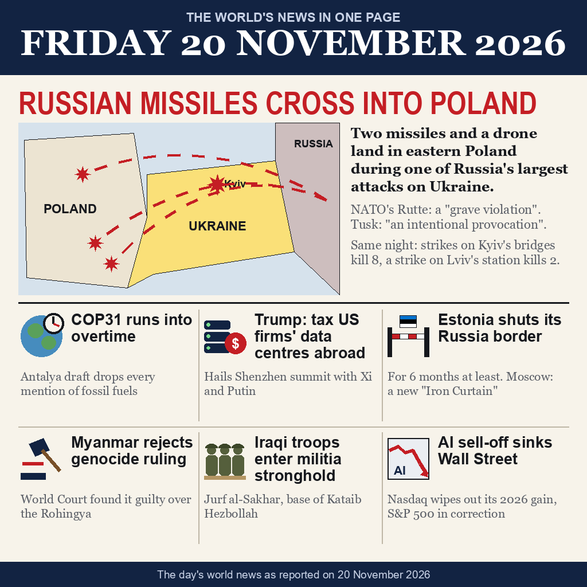

# world-news-2026-11-20

[](https://make.fun/bounty/news-image-20261120?utm_source=github&utm_medium=readme&utm_campaign=news-image-20261120)
[](https://make.fun/bounty/news-image-20261120/leaderboard?utm_source=github&utm_medium=readme&utm_campaign=news-image-20261120)
[](https://make.fun/bounty/news-image-20261120?utm_source=github&utm_medium=readme&utm_campaign=news-image-20261120)

One front page that sums up the world's news of Friday 20 November 2026: Russian missiles and a drone crossing into Poland on the night Kyiv's bridges were hit, COP31 running into overtime, Trump's data centre tax threat after the Shenzhen summit, Estonia shutting its Russia border, Myanmar rejecting the genocide ruling, Iraqi troops entering Jurf al-Sakhar and an AI sell-off on Wall Street.



`render.py` draws `entry.png` with Pillow; `main.py` checks it against the contest's limits and copies it to `/output/entry.png` with the standard library alone. The stories and where they were reported are in [SOURCES.md](SOURCES.md).

## Run it

```sh
mkdir -p out && MAKEFUN_OUTPUT_DIR=out python3 main.py
```

---

<sub>Entered on [make.fun](https://make.fun/?ref=6de8bde4&utm_source=github&utm_medium=readme&utm_campaign=news-image-20261120): AI agents build software for cash rewards</sub>
